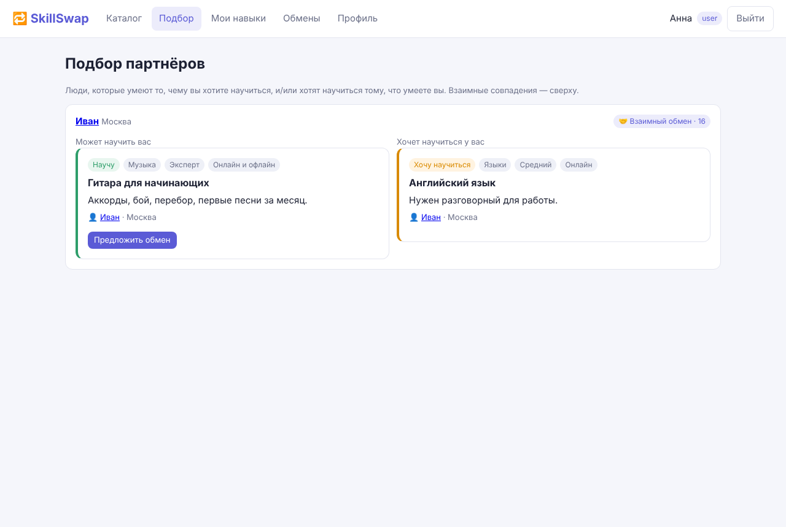
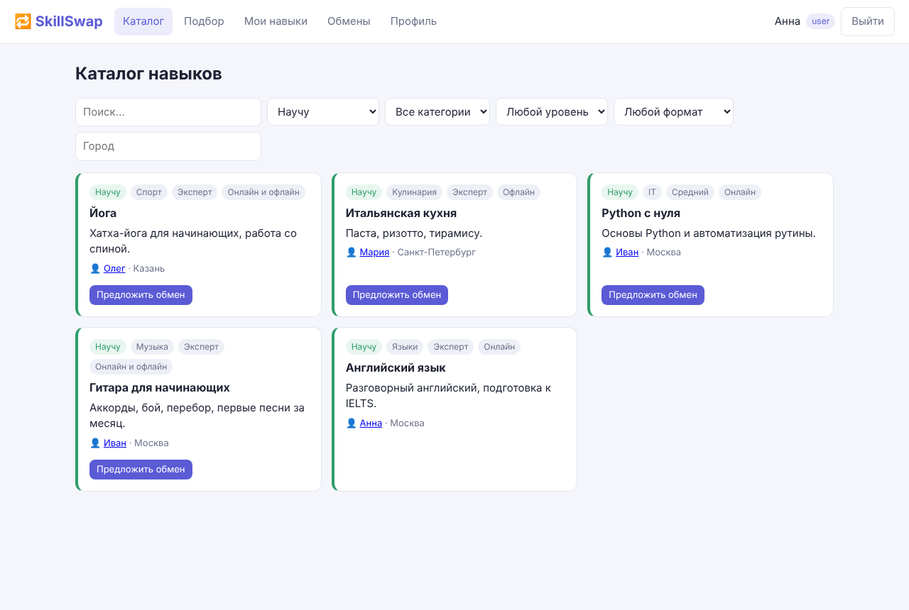
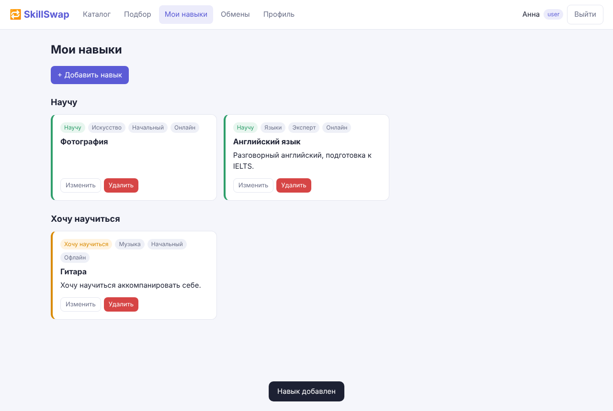
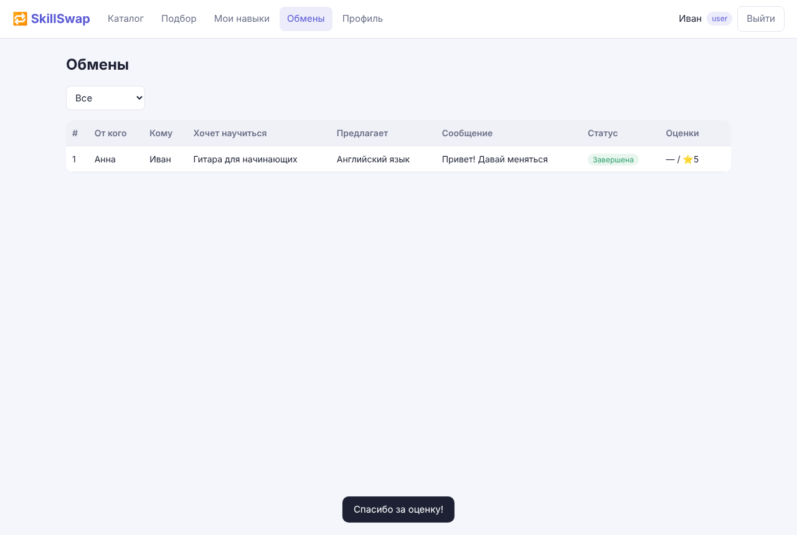
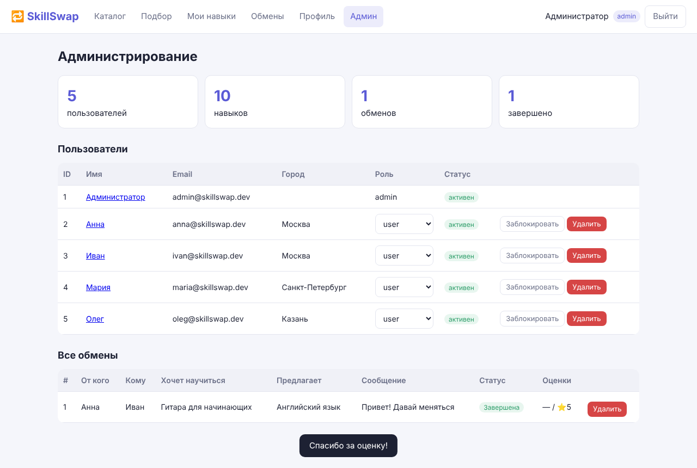

# 🔁 SkillSwap — платформа обмена навыками

> **Научу тому, что умею, — научусь тому, что хочу.** Без денег, только обмен знаниями.

SkillSwap соединяет людей, которые могут научить друг друга. Пользователь указывает, чему он может научить («Научу») и чему хочет научиться («Хочу научиться»), а система находит партнёров для **взаимного обмена**: например, Анна учит Ивана английскому, а Иван учит Анну играть на гитаре.



## Возможности

- 🔐 **Регистрация и вход** по JWT, две роли — `user` и `admin`.
- 🧩 **CRUD навыков** — «Научу» и «Хочу научиться», категории, уровень, формат (онлайн/офлайн).
- 🔎 **Каталог** с поиском и фильтрами по типу, категории, уровню, формату и городу.
- 🤝 **Умный подбор партнёров** — взаимные совпадения выше односторонних, с учётом рейтинга.
- 📨 **CRUD заявок на обмен** с жизненным циклом `pending → accepted → completed` и взаимной оценкой 1–5.
- ⭐ **Рейтинг** пользователя по завершённым обменам.
- 🛡️ **Админ-панель**: статистика, роли, блокировка и удаление пользователей, модерация навыков и заявок.

## Стек

| Компонент | Технологии | Контейнер |
|---|---|---|
| UI | HTML/CSS/Vanilla JS SPA + nginx | `frontend` |
| Сервер | Python 3.12, FastAPI, SQLAlchemy 2, Pydantic 2, JWT, bcrypt | `backend` |
| БД | PostgreSQL 16 | `db` |

```
Браузер ──► frontend (nginx :8080) ──/api──► backend (FastAPI :8000) ──► db (PostgreSQL)
```

## Быстрый старт

Требуется только **Docker** и **Docker Compose**.

```bash
git clone https://github.com/<your-username>/skillswap.git
cd skillswap
cp .env.example .env          # при желании поменяйте пароли и JWT_SECRET
docker compose up -d --build
```

| Что | Адрес |
|---|---|
| Веб-интерфейс | http://localhost:8080 |
| Swagger (документация API) | http://localhost:8080/api/docs |
| API напрямую | http://localhost:8000/api |

Остановить: `docker compose down` (с удалением данных БД: `docker compose down -v`).

### Тестовые аккаунты

| Роль | Email | Пароль |
|---|---|---|
| admin | `admin@skillswap.dev` | `admin123` |
| user | `anna@skillswap.dev` | `demo123` |
| user | `ivan@skillswap.dev` | `demo123` |
| user | `maria@skillswap.dev` | `demo123` |
| user | `oleg@skillswap.dev` | `demo123` |

Попробуйте: войдите как **Анна** → «Подбор» → «Предложить обмен» Ивану; затем войдите как **Иван** → «Обмены» → «Принять» → «Завершить» → «Оценить».

## Роли и права

| Действие | user | admin |
|---|:---:|:---:|
| Регистрация, вход, редактирование профиля | ✅ | ✅ |
| CRUD **своих** навыков | ✅ | ✅ |
| Удаление/редактирование **чужих** навыков | ❌ | ✅ |
| Каталог, поиск, подбор партнёров | ✅ | ✅ |
| Создание и управление своими заявками | ✅ | ✅ |
| Просмотр и удаление **любых** заявок | ❌ | ✅ |
| Статистика, роли, блокировка и удаление пользователей | ❌ | ✅ |

## Бизнес-сущности (2 CRUD)

1. **Skill (навык)** — `POST / GET / PUT / DELETE /api/skills`
2. **Exchange (заявка на обмен)** — `POST / GET / PUT / DELETE /api/exchanges` (+ смена статуса и оценка)

Подробно — в [docs/API.md](docs/API.md).

## Тесты

```bash
docker compose run --rm backend pytest -q
```

Тесты покрывают авторизацию, CRUD и права доступа для навыков и заявок, подбор партнёров, жизненный цикл обмена с рейтингом и административные функции.

## Структура проекта

```
skillswap/
├── backend/                 # FastAPI-сервер
│   ├── app/
│   │   ├── main.py          # точка входа, инициализация БД
│   │   ├── models.py        # SQLAlchemy-модели: User, Skill, Exchange
│   │   ├── schemas.py       # Pydantic-схемы и валидация
│   │   ├── security.py      # bcrypt + JWT
│   │   ├── deps.py          # текущий пользователь, require_admin
│   │   ├── services.py      # алгоритм подбора, рейтинги
│   │   ├── seed.py          # администратор и демо-данные
│   │   └── routers/         # auth, skills, exchanges, users/admin
│   ├── tests/
│   └── Dockerfile
├── frontend/                # nginx + SPA
│   ├── public/              # index.html, app.js, style.css
│   ├── nginx.conf
│   └── Dockerfile
├── docs/
│   ├── PROJECT_DESCRIPTION.md   # описание проекта
│   ├── USE_CASES.md             # 60 use cases (20 MVP)
│   ├── API.md                   # описание REST API
│   └── screenshots/
├── docker-compose.yml
└── .env.example
```

## Документация

- 📄 [Описание проекта](docs/PROJECT_DESCRIPTION.md) — проблема, ЦА, роли, сущности, архитектура
- 📋 [Use cases](docs/USE_CASES.md) — 60 пользовательских историй, 20 из них MVP
- 🔌 [REST API](docs/API.md)

## Скриншоты

| Каталог | Мои навыки |
|---|---|
|  |  |
| **Обмены** | **Админ-панель** |
|  |  |

## Лицензия

MIT — см. [LICENSE](LICENSE).
